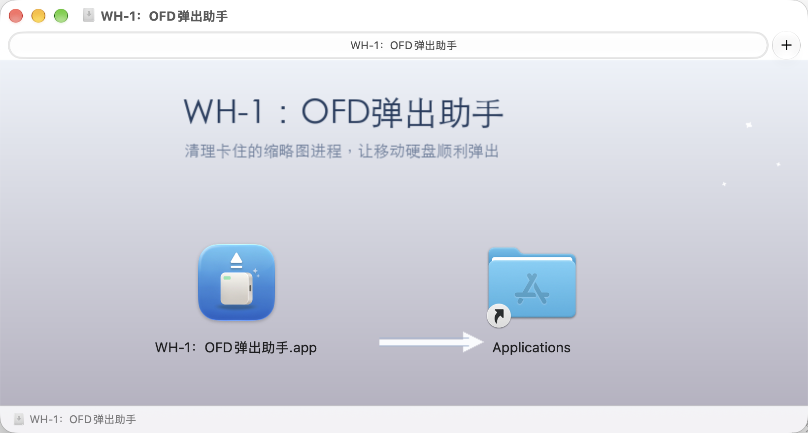

# WH-1：OFD弹出助手

[](https://github.com/drdr19/ofd-eject-helper/actions/workflows/build.yml)


> 一个小小的 macOS 工具：一键找出卡住的 OFD 缩略图进程，清理掉，然后你就可以正常弹出移动硬盘了。



## 这个工具解决什么问题

macOS 26 起系统原生支持 **OFD**（国内电子发票格式）的预览和缩略图，靠的是系统自带的 Quick Look 缩略图扩展 `OFD_Thumbnail.appex`。

这个扩展有个小毛病：只要它读过一次移动硬盘里的 `.ofd` 文件，就可能**一直挂在后台不退出**，一直攥着文件句柄不释放。于是你明明什么都没干，Finder 却告诉你：

> 磁盘"XXX"没有被推出，因为一个或多个程序可能正在使用它。

手动去「活动监视器」里翻进程又很难找到——它叫 `OFD_Thumb`，藏在系统框架里。这个工具就是替你做这件事：

1. 启动后自动检测有没有卡住的 OFD 缩略图进程
2. 弹窗告诉你结果
3. 让你选择「清理此进程」或「不清理此进程」
4. 清理完告诉你「好的」，点「完成」自动退出

**本工具不会自动弹出硬盘**，清理完请自行在 Finder 里弹出。

## 安装

### 方式一：下载安装包（推荐）

1. 到 [Releases](https://github.com/drdr19/ofd-eject-helper/releases) 页面下载最新的 `WH-1-OFD-Eject-Helper.dmg`
2. 双击打开，把 **WH-1：OFD弹出助手** 拖进「应用程序」文件夹
3. **首次打开需要右键点击 App → 选择「打开」**（因为本 App 使用 ad-hoc 自签名，没有 Apple 开发者证书）

> 如果从微信 / 网盘下载后被系统拦截，可以打开「终端」执行：
> ```bash
> xattr -cr "/Applications/WH-1：OFD弹出助手.app"
> ```
> 然后再右键 →「打开」。

### 方式二：从源码构建

```bash
git clone https://github.com/drdr19/ofd-eject-helper.git
cd ofd-eject-helper

# 依赖：Xcode Command Line Tools + dmgbuild
pip3 install dmgbuild

# 一键构建（产出 dist/WH-1-OFD-Eject-Helper.dmg，通用二进制支持 Intel + Apple Silicon）
bash scripts/build.sh
```

## 使用

双击 App，看到弹窗后：

| 弹窗提示 | 说明 |
| --- | --- |
| **检测到占用** | 有卡住的进程，选「清理此进程」即可 |
| **一切正常** | 没有卡住的进程，可以直接去弹出硬盘 |

清理完成后点「完成」，App 自动退出。

## 工作原理

- 用 `libproc` 的原生 API（`proc_listpids` + `proc_name`）枚举进程，匹配 `OFD_Thumbnail` / `OFD_Thumb`
  - 不用外部命令 `ps`，避免在无 Dock 图标的后台 App 里被系统挂起
- 对匹配到的 PID 发送 `SIGTERM`
- 这些进程属于当前用户，**不需要 sudo**

## 减少复发的建议

这个 App 只是「事后清理」。想从源头减少这种情况：

- 在 Finder 里进入该移动硬盘，按 `⌘J`，取消勾选「显示图标预览」——这一项收益最大
- 如果这块盘只用来存文件，可以关掉它的 Spotlight 索引：
  ```bash
  sudo mdutil -i off /Volumes/你的盘名
  ```

## 兼容性

- macOS 13.0 及以上
- 通用二进制（Apple Silicon + Intel）
- 无第三方依赖，纯 Swift + Cocoa，体积约 1.2 MB

## 项目结构

```
.
├── src/
│   ├── main.swift          # 全部源码（约 170 行）
│   └── Info.plist          # App 配置（Bundle ID / 版本 / 显示名）
├── scripts/
│   ├── build.sh            # 一键构建脚本（编译 → 图标 → 签名 → DMG → 自检）
│   ├── dmg_settings.py     # DMG 布局配置（背景图、图标位置）
│   ├── make_dmg_bg.py      # 生成 DMG 背景图（PingFang 中文字体）
│   └── make_transparent.py # 图标抠透明
├── assets/
│   ├── icon-1024.png       # App 图标源图
│   └── dmg-background.png  # 安装界面背景图
├── docs/
│   └── screenshot-dmg.png  # 安装界面截图
└── dist/                   # 构建产物（已 gitignore）
```

## 命名说明

`WH-1` 是编号前缀，方便同一系列的小工具按序号归档。App 的显示名、`.app` 包名、
DMG 卷名都带 `WH-1：` 前缀；DMG **文件名**保持 ASCII（`WH-1-OFD-Eject-Helper.dmg`），
因为 GitHub Release 会把中文附件名剥掉。

## 常见问题

**Q：为什么需要右键「打开」？**
A：因为没有 Apple 开发者证书（$99/年）做正式签名。ad-hoc 签名足够保证 App 完整未被篡改，只是 Gatekeeper 首次会拦一下。

**Q：清理进程会不会损坏硬盘数据？**
A：不会。该进程只以**只读**方式持有文件句柄，没有任何写入操作。

**Q：为什么只清理 OFD 缩略图进程，不处理其他占用？**
A：因为这是实测中唯一高频出现、且由系统自动触发、用户完全无感知的占用源。其他占用（如你自己开的文档）应该由你自己决定要不要关。

## License

[MIT](LICENSE)
